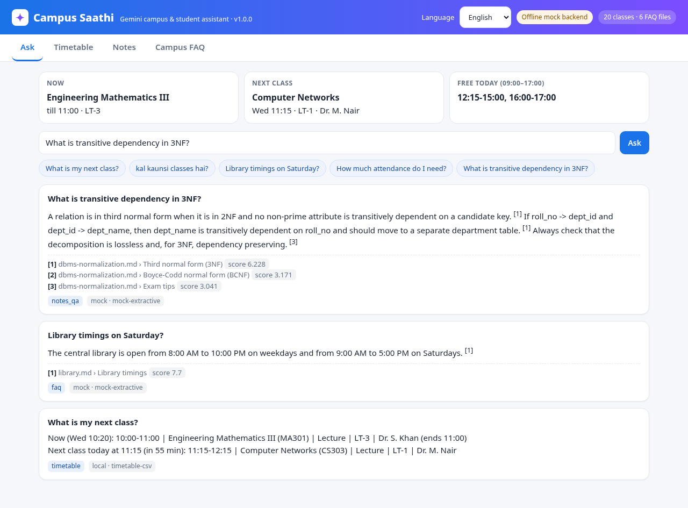
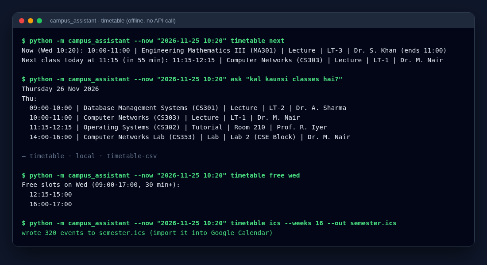
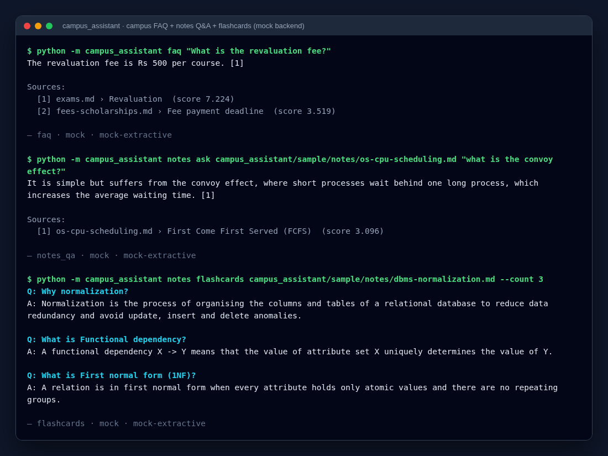
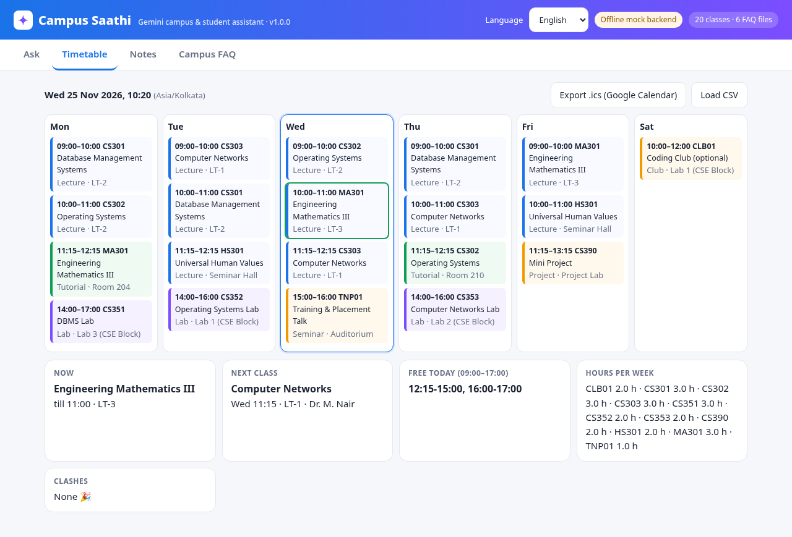
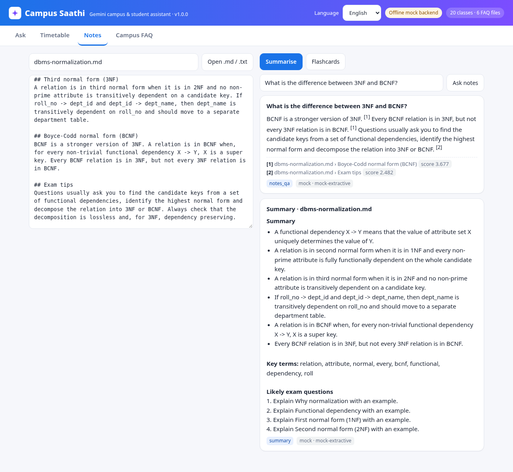
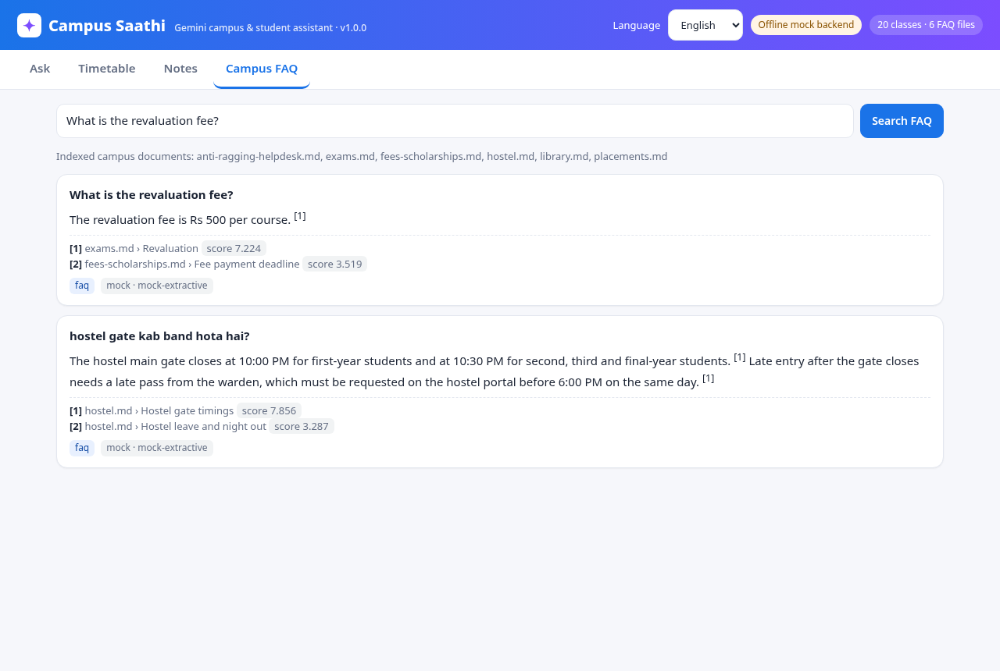
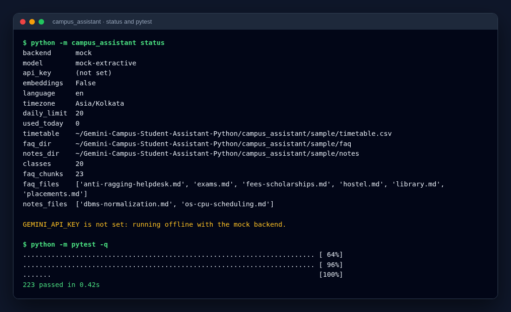

# Gemini Campus & Student Assistant (Python) — "Campus Saathi"

A **Gemini API student assistant** for Indian colleges. It answers the three things students ask
all day:

1. **Timetable** — *"What is my next class?"*, *"kal kaunsi classes hai?"*, free slots, clashes,
   hours per subject, and a one-click **.ics export for Google Calendar**.
2. **Notes** — summarise class notes for revision, make **flashcards**, and ask questions about your
   own notes with **cited answers**.
3. **Campus FAQ** — hostel, library, exams, fees, scholarships, placements: answered from your
   college's own documents with **retrieval (BM25, optional Gemini embeddings) and [1] citations**.
   If the answer is not in the documents it says so instead of guessing.

It has a **Flask web UI** and a **CLI**, answers in **English, Hindi or Hinglish**, and runs
**fully offline with a mock backend** when no `GEMINI_API_KEY` is set, so you can demo it in a lab
with no internet and run all the tests without a key.

📖 Full tutorial: **https://getprojects.org/gemini-student-assistant-python/**



## Features

- **Question router**: one box for everything. Timetable questions (English, Hinglish, Hindi day
  names like *somvar*) are answered **locally from your CSV with zero API calls**; study and campus
  questions go to retrieval + Gemini.
- **Timetable tools**: now / next class with "in 55 min", today / tomorrow / any day, free slots,
  clash detection, weekly hours, course lookup by name, code or short form (*DBMS*, *OS*, *CN*),
  `.ics` export for a whole semester.
- **Notes**: summary + key terms + likely exam questions, flashcards, Q&A over notes with citations.
  Long notes are trimmed to keep requests small.
- **Campus FAQ with retrieval**: markdown files are split by heading, indexed with BM25 (works
  offline), optionally re-ranked with `gemini-embedding-2` (hybrid search, cached on disk).
  Weak passages are dropped, and a "not found" answer is returned without calling the model.
- **Grounded prompts**: Gemini is told to answer only from the `<context>` block, cite passages and
  ignore instructions inside documents (basic prompt-injection hygiene).
- **Privacy**: phone numbers, emails, Aadhaar-like numbers and PAN numbers are masked **before**
  anything is sent to the API. The API key is read from the environment, sent in the
  `x-goog-api-key` header (never in the URL) and never printed.
- **Free-tier friendly**: a daily request cap (`CAMPUS_DAILY_LIMIT`, default 20), retry with
  backoff on 429/5xx that honours `Retry-After`, and clear hints for bad keys, unknown models and
  exhausted quotas.
- **Safe local web UI**: listens on 127.0.0.1 only, blocks DNS-rebinding Host headers, needs a
  custom header for POST (CSRF guard), strict CSP, request size limits.
- **No SDK lock-in**: the Gemini client is ~120 lines of standard-library REST, so the only
  dependency is Flask.
- **223 pytest tests**, all offline (the Gemini API is faked at the HTTP layer).

## Quick start

```bash
git clone https://github.com/GetProjectsIdea/Gemini-Campus-Student-Assistant-Python.git
cd Gemini-Campus-Student-Assistant-Python
python -m venv .venv && source .venv/bin/activate      # Windows: .venv\Scripts\activate
pip install -r requirements-dev.txt

python -m campus_assistant demo                  # offline tour, no key needed
python -m campus_assistant web                   # http://127.0.0.1:5077
python -m pytest -q                              # 223 passed
```

### Use the real Gemini API

```bash
export GEMINI_API_KEY="your-key-from-aistudio.google.com"   # never commit this
python -m campus_assistant status                # shows backend=gemini and a masked key
python -m campus_assistant ask "What is the library fine?"
python -m campus_assistant --lang hinglish ask "hostel gate kab band hota hai?"
```

The default model is `gemini-4-hydrogen` (has a free tier on the Gemini API as of November 2026).
If you keep hitting the free daily limit, switch to the lighter model:

```bash
export GEMINI_MODEL=gemini-3.5-flash-lite
```

Model names change often: check the [Gemini models / deprecations page](https://ai.google.dev/gemini-api/docs/deprecations)
and your live limits in [AI Studio](https://aistudio.google.com/).

## CLI

```bash
python -m campus_assistant ask "What is my next class?"
python -m campus_assistant timetable today|tomorrow|next|week
python -m campus_assistant timetable day thu
python -m campus_assistant timetable free wed
python -m campus_assistant timetable clashes            # exit code 1 if any clash
python -m campus_assistant timetable ics --weeks 16 --out semester.ics
python -m campus_assistant faq "revaluation fee"
python -m campus_assistant faq --sources
python -m campus_assistant notes summarise my-notes.md
python -m campus_assistant notes flashcards my-notes.md --count 10
python -m campus_assistant notes ask my-notes.md "difference between 3NF and BCNF"
python -m campus_assistant --json ask "library timings"   # JSON for scripts
python -m campus_assistant --embeddings faq "late book penalty"   # hybrid search
python -m campus_assistant --now "2026-11-23 09:40" ask "next class"  # pretend time (demos)
```




## Use your own college data

| What | Where | Format |
|---|---|---|
| Timetable | `CAMPUS_TIMETABLE` or `--timetable` | CSV: `day,start,end,course,code,type,room,faculty,short` (only the first four are required; 24h or `2:00 PM` times) |
| Campus FAQ | `CAMPUS_FAQ_DIR` or `--faq-dir` | folder of `.md` / `.txt` files; use `##` headings per topic |
| Notes | `CAMPUS_NOTES_DIR` or `--notes-dir` | folder of `.md` / `.txt` files |

The samples in `campus_assistant/sample/` are a made-up engineering college (B.Tech CSE, 5th semester). Replace
them with your own handbook, hostel rules and timetable. In the web UI you can also load a timetable
CSV and paste or open notes without touching any files.

## Screenshots

| | |
|---|---|
|  |  |
|  |  |

## Project structure

```
campus_assistant/
  assistant.py   CampusAssistant: router + timetable + notes + FAQ + model calls
  backends.py    GeminiBackend (REST: generateContent, batchEmbedContents) + offline MockBackend
  retrieval.py   BM25 index, KnowledgeBase, optional embedding re-rank with cache
  timetable.py   CSV loader, next/free/clashes/hours, .ics export
  router.py      intent + day detection (English / Hinglish / Hindi)
  prompts.py     grounded system prompt, Q&A / summary / flashcard prompts
  textutil.py    tokenizer, sentence splitter, markdown chunker, PII redaction
  usage.py       daily request cap
  web.py         Flask UI + JSON API     cli.py  command line     demo.py  offline tour
  sample/      timetable.csv, faq/*.md, notes/*.md (demo college data, shipped with the package)
tests/           223 pytest tests (no network)
docs/            screenshots and sample outputs
```

## Environment variables

See [`.env.example`](.env.example). Main ones: `GEMINI_API_KEY`, `GEMINI_MODEL`,
`GEMINI_EMBED_MODEL`, `CAMPUS_BACKEND` (`auto`/`mock`/`gemini`), `CAMPUS_LANG`
(`en`/`hi`/`hinglish`), `CAMPUS_DAILY_LIMIT`, `CAMPUS_EMBEDDINGS`, `CAMPUS_REDACT`, `CAMPUS_TZ`.

## Ideas to extend it (final-year project upgrades)

- Read PDFs of notes (e.g. with `pypdf`) and slice long PDFs into pages.
- Attendance tracker: mark present/absent and warn when a course drops below 75%.
- Telegram or WhatsApp bot front-end for the same `CampusAssistant` class.
- Admin page for the college office to upload FAQ documents.
- Evaluate answer quality: a small set of questions with expected sources, and measure hit rate.

## Notes

- Free-tier Gemini prompts may be used by Google to improve its products; do not paste private data.
  This project masks common personal identifiers, but you are responsible for what you upload.
- The mock backend is extractive (it picks sentences from the retrieved passages). It does not
  translate, so Hindi/Hinglish output needs the real Gemini backend.

## License

MIT © 2026 Pardeep Patel · Made for [GetProjects](https://getprojects.org/)
